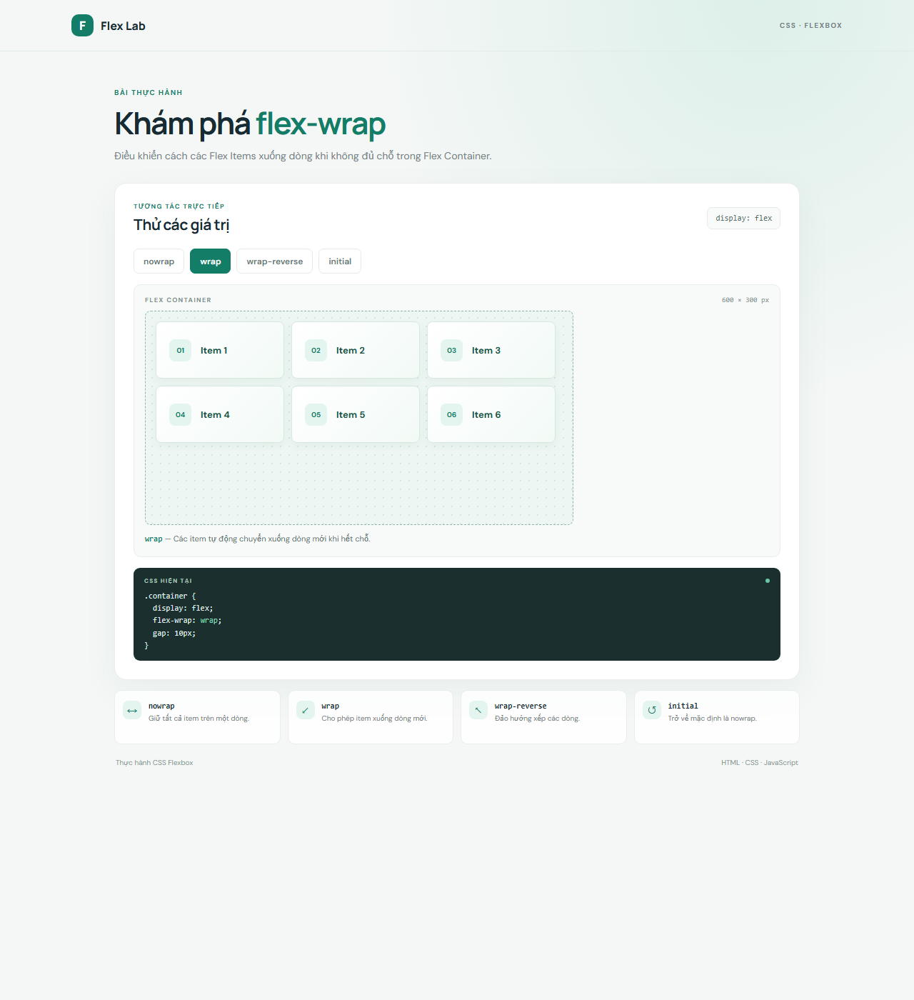

# CSS Flexbox: `flex-wrap`

Bài thực hành minh họa các giá trị `nowrap`, `wrap`, `wrap-reverse` và `initial`. Nhấn các nút để đổi giá trị và quan sát sáu Flex Items được sắp xếp lại trong container.

## Chạy bài

Mở `index.html` trong trình duyệt. Không cần cài đặt thư viện hay công cụ build.

## Ảnh kết quả

